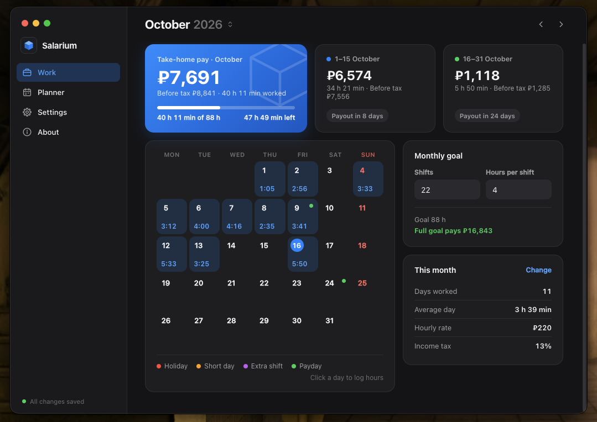

# Salarium

Log the hours you worked, see how much you'll get paid.

Any pay schedule: payouts on your own dates (from once to 31 times a
month) or every N days (daily, weekly, every two weeks), with weekend
paydays moved to the Friday before (can be turned off). A monthly goal,
days off and short days, a shift planner with breaks, and a read-only lock
on past months. Light and dark mode, seven languages (Russian, English,
Spanish, German, French, Chinese, Japanese), any currency.



## Install

**macOS**

```sh
curl -fsSL https://raw.githubusercontent.com/drugdamage/salarium/main/install.sh | sh
```

**Windows** (PowerShell)

```powershell
irm https://raw.githubusercontent.com/drugdamage/salarium/main/install.ps1 | iex
```

The command installs the latest version and starts it; run it again to
update. You can also download the zip from the
[latest release](https://github.com/drugdamage/salarium/releases/latest).

---

## Connect your database

Your data is stored in your own free Supabase database. On first launch
Salarium asks for it and walks you through these steps.

### 1. Create a Supabase project

1. Go to [supabase.com](https://supabase.com) and sign in (GitHub login works).
2. Click **New project**.
3. Enter any name (e.g. `salarium`), make up a database password, and
   pick the region closest to you.
4. Click **Create new project** and wait 1–2 minutes until it's ready.

> If the Supabase site doesn't load or looks broken, turn off your ad
> blocker (uBlock etc.) for supabase.com.

### 2. Create the table

1. In your project, open **SQL Editor** from the left sidebar (the `>_` icon).
2. Paste this (the app has a **Copy** button for it):

   ```sql
   create table if not exists kv_store (
     key text primary key,
     value jsonb,
     updated_at timestamptz default now()
   );
   alter table kv_store enable row level security;
   create policy "salarium" on kv_store for all to anon using (true) with check (true);
   ```

3. Click **Run**. You should see `Success. No rows returned`.

### 3. Paste your keys into Salarium

1. In Supabase, click **Connect** at the top of the project page (or go to
   **Project Settings → API Keys**).
2. Copy the **Project URL** (`https://abcdefghijkl.supabase.co`) and the
   **publishable key** (starts with `sb_publishable_`; on older projects
   it's called the **anon** key).
3. Paste both into Salarium and click **Connect**.

The key works like a password to your database, so don't share it. To
switch to another project later, open **Settings → Database → Change**.

Then open **Settings** to pick your language, currency, theme, hourly rate,
tax and pay schedule.

---

## Run from source

1. Install [Node.js](https://nodejs.org) 18 or newer.
2. Clone this repository: `git clone https://github.com/drugdamage/salarium.git`
3. In its folder, run `npm install`, then `npm start`.

To build the app yourself, double-click `SETUP.command` (macOS) or
`SETUP.bat` (Windows); it ends up in `dist/`. Optionally, copy
`config.example.js` to `config.js` with your keys to skip the setup screen.

---

## License

[MIT](LICENSE)
